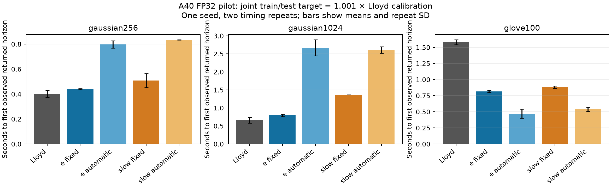

# e-means: an independent research reproduction

NumPy and PyTorch implementations of Lloyd’s K-Means and **e-means**, with numerical oracles, CPU/CUDA parity checks, reproducible experiments and an audited NVIDIA A40 performance study.

Based on Bessa et al., [*e-means: outperforming k-means (in one-tenth the epochs)*](https://arxiv.org/abs/2611.09501v1) (2026), with the [pinned authors’ Faiss implementation](https://github.com/facebookresearch/faiss/tree/2b648f0605f2ef3d14c4705350f8a0b214463878/contrib/e_means) used for comparison. The library is independently written; authors’ code is fetched explicitly for optional tests and is not a runtime dependency.

**Finalized research snapshot · Phases 1–4 complete · No further experiments planned.** The full suite passed **199 tests with zero skips on an NVIDIA A40**. Final local verification: **166 passed, 33 NVIDIA-only skips**. The larger 936-fit study and Phase 5 optimization were not executed. Cloud Pods and temporary volumes were deleted.

## Motivation and scope

An optimizer can need fewer data passes while still taking longer on a GPU. This project separates mathematical correctness, statistical convergence and backend performance through independently checked updates, shared inputs, matched-quality targets and measured profiling.

The implementation covers sum/count EMA updates, cosine annealing, dead-cluster revival, published automatic batch/step laws, last-epoch mean finalization and an explicitly documented slow-EMA interpretation. Both NumPy and PyTorch support FP32/FP64. PyTorch runs on CPU or CUDA and uses chunked direct-distance assignment to bound scratch memory. Correctness takes priority over kernel throughput.

This is a **research reproduction and engineering study**, not novel algorithmic research or a production clustering service. We do **not** claim reproduction of the paper’s reported 10–45× GPU speedups.

## Independently measured findings

Phase 4 A40 FP32 pilot: one independent seed, two timing repeats, identical data and initial centroids. Seconds below are means for the first declared fresh-fit horizon meeting **both train and test MSE ≤ 1.001 × an independent Lloyd calibration**, with final-only observation.

| Workload | Lloyd | e-means, fixed | e-means, automatic |
|---|---:|---:|---:|
| Gaussian 256D | 0.402 s | 0.440 s | 0.797 s |
| Gaussian 1024D | 0.656 s | 0.792 s | 2.668 s |
| GloVe 100D subset | 1.581 s | 0.818 s | 0.471 s |

Automatic e-means reached the GloVe threshold 3.36× sooner using the ratio of mean times, but remained slower on both Gaussian workloads. Fewer epochs did not guarantee lower wall time. This is equal-threshold attainment on a finite budget grid, not identical terminal MSE or continuous early stopping.



- Phase 2: **120 real-data CPU fits**, five seeds, two repeats; all 60 paired FP64 NumPy/PyTorch center and label results matched exactly.
- Phase 3: **186 actual A40 fits**, including FP32/FP64; lower final e-means MSE on the larger development workloads, with workload-dependent runtime.
- Phase 4: **9 GPU profiles, 312 primary quality fits**, scaling-law sensitivity, six native GPU comparison pairs and 24 isolated Faiss CPU fits. All primary fits completed; 104/648 target observations were censored.
- Assignment/dispatch dominated the instrumented profiles. The authors’ native assignment path was substantially faster under aligned controls; backend diagnostics are not algorithmic speedup claims. Faiss comparisons were **CPU-only**.

The [final reproduction report](REPRODUCTION_REPORT.md) includes full methods, uncertainty, CPU/GPU tables, hardware, bottlenecks, source differences and limitations. [Public evidence](artifacts/README.md) includes raw numeric records/arrays, historical independent source snapshots, configurations, validation XML, plots and SHA256 manifests. Full profiler traces remain preserved in local checksummed exports; no public download URL is claimed.

## Install and test

Python 3.10+; NumPy is the only required runtime dependency. Historical measurements use the pinned environments recorded in the report, rather than every version allowed by package metadata.

```bash
git clone https://github.com/BeleRohit/e-means.git
cd e-means
python3 -m venv .venv
.venv/bin/python -m pip install -e '.[test,torch,experiments]'
.venv/bin/python -m pytest -q
```

CPU-only machines skip CUDA tests. Optional reference checks need Faiss and four pinned source files:

```bash
.venv/bin/python -m pip install -e '.[reference]'
.venv/bin/python scripts/fetch_reference.py /tmp/emeans-reference-2b648f --native-torch
EMEANS_REFERENCE_DIR=/tmp/emeans-reference-2b648f .venv/bin/python -m pytest -q
```

Reference downloads are explicit and SHA256 checked. Without optional dependencies/reference files, additional tests skip; a local pass is not a new CUDA certificate.

## Minimal example

```python
import numpy as np
from e_means import EMeans, EMeansConfig, LloydKMeans, LloydConfig

x = np.random.default_rng(7).normal(size=(1000, 32))
initial = x[:8].copy()
lloyd = LloydKMeans(LloydConfig(n_clusters=8, max_iter=25)).fit(
    x, init_centroids=initial)
emeans = EMeans(EMeansConfig(n_clusters=8, epochs=3, seed=7)).fit(
    x, init_centroids=initial)
print(lloyd.mse_, emeans.mse_)  # Squared Euclidean error per vector
```

Use `TorchLloydKMeans` or `TorchEMeans` with the same configurations and `device="cpu"`/`"cuda"`. `finalize="slow_ema"` selects the documented shadow estimator. See [API conventions](docs/API.md) and the [walkthrough notebook](notebooks/walkthrough.ipynb). Outputs, moving-state history and returned finalizers are deliberately distinguished.

## Reproduce and audit

Offline publication integrity check; this does not train a model or access the cloud:

```bash
python3 scripts/verify_publication.py
```

Historical experiment commands, dataset acquisition and exact measurement scopes are in [reproduction notes](REPRODUCTION_NOTES.md), [the final report](REPRODUCTION_REPORT.md) and [Runpod instructions](docs/RUNPOD.md). Downloaded data is excluded from Git; fetchers verify pinned bytes/arrays and retain original splits. The raw evidence archive is separate from the publication package.

To create a local, verified publication bundle without uploading anything:

```bash
python3 scripts/archive_project.py --output archives/e-means-reproduction.tar.gz
```

## Repository guide

| Path | Purpose |
|---|---|
| `src/e_means/` | Independent estimators, schedules, state, assignments and measurement tools |
| `tests/` | Scalar/numerical oracles, regression fixtures, CPU/CUDA and reference checks |
| `configs/` | Saved CPU/GPU protocols, including the explicitly unexecuted 936-fit plan |
| `scripts/`, `runpod/` | Acquisition, validation, measurement, audit and pinned environment tools |
| `notebooks/` | Unexecuted educational walkthrough; not benchmark evidence |
| `artifacts/public/`, `docs/figures/` | Curated measured results and plots suitable for publication |
| `PAPER_MAPPING.md`, `REPRODUCTION_NOTES.md` | Equation mapping, ambiguities and implementation differences |
| `EXPERIMENT_LOG.md`, `PHASE4_REPORT.md` | Dated historical research record and detailed A40 pilot |
| `PUBLICATION.md`, `NOTICE.md` | Publication checklist, project descriptions and attribution/licensing scope |

No API keys, SSH credentials, virtual environments, downloaded corpora or account/controller files belong in the public package. No repository visibility change or upload is performed by the archive tools. Historical source snapshots remain authoritative for measured runs; finalization changes documentation and packaging, not validated algorithms.

## Citation and attribution

```bibtex
@misc{bessa2026emeans,
  title={e-means: outperforming k-means (in one-tenth the epochs)},
  author={Bessa, Swann and Mazaré, Pierre-Emmanuel and Szilvasy, Gergely and
          Touvron, Hugo and Picard, David and Douze, Matthijs and Jégou, Hervé},
  year={2026},
  eprint={2611.09501},
  archivePrefix={arXiv}
}
```

Credit the original paper for the algorithm; describe this repository as an independent reproduction. See [NOTICE.md](NOTICE.md) for reference/data attribution and the project’s currently unselected code license.
