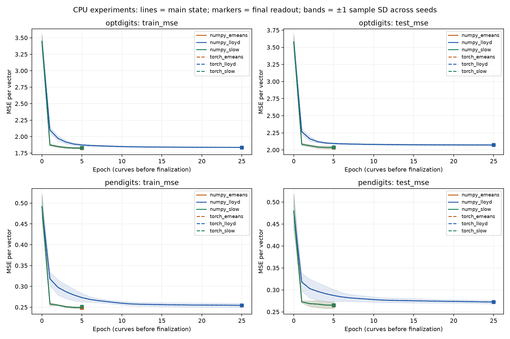
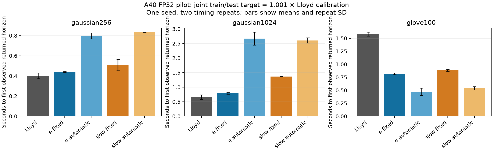
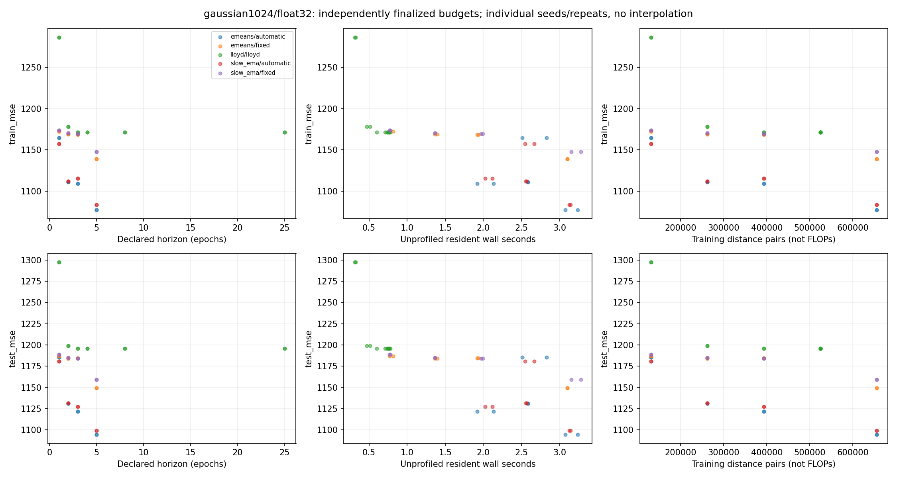
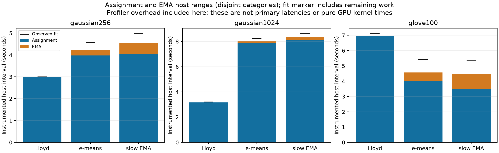

# Final e-means reproduction report

**Finalized 12 November 2026. Scope: Phases 1–4; no Phase 5 optimization or additional experiments.**

This repository independently implements and evaluates the algorithm in Bessa et al., [*e-means: outperforming k-means (in one-tenth the epochs)*](https://arxiv.org/abs/2611.09501v1). The paper is the primary specification; the [authors’ Faiss contribution](https://github.com/facebookresearch/faiss/tree/2b648f0605f2ef3d14c4705350f8a0b214463878/contrib/e_means) supplies a pinned optional oracle and implementation comparisons. This is a research reproduction, not a new clustering algorithm. The independent library does not vendor or execute the authors’ code at runtime.

## Evidence and claims

The paper reports 10–45× GPU speedups in its own experiments, using optimized implementations and much larger embedding workloads. **We did not reproduce that speedup range.** Our measurements use an independently written, correctness-oriented direct-distance backend and NVIDIA A40 hardware. Fewer epochs, lower MSE and lower wall time are distinct outcomes.

| Stage | Validation | Independently measured experiments |
|---|---|---|
| Phase 1 | 54 passing NumPy tests | 12 synthetic Lloyd/e-means fits |
| Phase 2 | 101 passing tests, 4 CUDA skips locally | 120 CPU fits: two UCI datasets, six methods, five seeds, two repeats |
| Phase 3 | 178 tests passed on A40, zero skips | 24 GPU smoke + 162 GPU research fits |
| Phase 4 | 199 tests passed on A40, zero skips | 9 profiles, 312 primary quality fits, 6 native GPU pairs, 24 isolated official Faiss CPU fits |
| Finalization | 166 passed, 33 NVIDIA-only skips locally | Offline audits and packaging only; no new training experiments |

The Phase 4 GPU pairs contain 12 full fits plus assignment measurements. Warmups, calibrations and exact-output diagnostic replays are additional executions, not included in the 312 primary count. An earlier separate 24-fit macOS Faiss CPU study remains in the historical log and is not pooled with the Runpod CPU comparison. Notebook cells are unexecuted educational material, not empirical evidence.

Public numeric records, arrays, source/configuration snapshots and validation XML are under [artifacts/public](artifacts/public). Full lossless raw profiler exports remain in the local research archive, as explained in [artifacts/README.md](artifacts/README.md). No nonexistent public archive link is implied.

## Independent implementation and correctness

The NumPy and PyTorch backends implement full-batch Lloyd assignment/mean iterations and mini-batch e-means with explicit EMA sums and masses. For batch statistics s and n, they update S ← (1−alpha)S + alpha s and N ← (1−alpha)N + alpha n, then read centers as S/N. Shared functions implement the literal cosine schedule and published automatic batch/step laws. Revival checks run every five global updates with documented donor selection and splitting. Final outputs use either last-epoch moving-assignment means or an independent constant-speed shadow EMA.

Tests include scalar arithmetic/training oracles, tiled assignment against broadcast distances, first-index ties, large-offset and overflow behavior, primitive and full-trajectory NumPy/PyTorch parity, controlled identical initialization/order/donors, FP32/FP64, revival geometry, retained/dropped tails and both finalizers. Immutable Phase 1 arrays remain regression fixtures. Primitive tolerances are atol/rtol 3e-6 for FP32 and 2e-12 for FP64; CUDA trajectory budgets are 1e-4 and 1e-10 respectively. Controlled labels/donor identities must still agree exactly. These are tested tolerances, not universal error bounds near assignment boundaries.

Actual A40 validation covered all 199 collected tests without skips, including the CUDA profiler/event probe. The final local suite is CPU-only and does not renew a CUDA gate for the final packaging fingerprint. Historical measured runs retain their exact source ZIPs and validation certificates. Finalization changes documentation, packaging metadata and offline archive tools, not validated algorithms.

## Methods and hardware

| Environment | Recorded specification |
|---|---|
| CPU study | macOS ARM64, Python 3.13.7; package/platform/thread metadata in historical manifest; exact marketing CPU model was not recorded |
| GPU | Runpod Secure Cloud NVIDIA A40, SM 8.6, 84 SMs, 46,068 MiB visible memory |
| GPU software | Linux x86_64, driver 595.91.07, Python 3.11.10, PyTorch 2.5.1+cu124, CUDA 12.4, cuDNN 9.1, NumPy 1.26.4 |
| GPU policy | Deterministic algorithms enabled, TF32 disabled, CUBLAS_WORKSPACE_CONFIG=:4096:8, CPU math threads one |
| Container | Immutable image digest and exact dependency overlay in runpod/image.json and runpod/requirements.lock |
| Phase 4 precision/design | FP32, seed 0, two timing repeats, one warmup; shared data/init and recorded randomized job order |

Phase 3 used a different physical A40 from Phase 4; UUIDs and complete driver/runtime metadata remain in each manifest. All three Phase 4 FP32 seed-zero data/init hashes exactly match Phase 3. Phase 3 summaries average repeats within seed, then report mean/sample SD across three seeds. Phase 4 timing-repeat SD is not independent-seed uncertainty or a confidence interval.

### Datasets

CPU studies use UCI optical digits (3,823/1,797 train/test, 64 features) and pen digits (7,494/3,498, 16 features), with labels discarded, original splits and fixed published-range scaling. GPU studies use:

| Workload | Train / test rows | Dimensions | k |
|---|---:|---:|---:|
| Gaussian256 | 8,192 / 2,048 | 256 | 64 |
| Gaussian1024 | 4,096 / 1,024 | 1,024 | 32 |
| GloVe100 subset | 16,384 / 2,048 | 100 | 64 |

GloVe uses pinned ANN-Benchmarks byte ranges and prepared-array SHA256, original held-out groups and no fitted preprocessing. The whole parent file was not SHA256-verified. Prefix selection can be biased. Squared Euclidean clustering error differs from the source benchmark’s angular retrieval metric. Provenance, credits and acquisition commands are in [data/README.md](data/README.md).

### Timing, memory and quality

GPU primary latency is an unprofiled, synchronized resident fit plus returned train/test evaluation. H2D/loading, process startup and serialization are excluded. CUDA-event intervals, synchronized wall time, allocator baselines/peaks and actual executed epochs are retained. Event intervals may contain host submission gaps; they are not pure kernel time. Allocated/reserved memory excludes driver/context overhead. CPU fit wall time includes conversion and epoch evaluation; whole-process RSS is not isolated optimizer memory.

Phase 3 compares fixed budgets, including intermediate evaluations and Lloyd’s original exact-fixed-point early stopping. Its raw runtime ratios therefore do not establish equal-quality speedups. Phase 4 measures both every-epoch and final-only evaluation, with exact-output diagnostics separately from primary timing. All **132 observation-policy pairs have bit-identical centers and labels**.

## CPU findings: Phase 2

All **60 paired FP64 NumPy/PyTorch center and label results matched exactly** across the 120 fits. Representative returned test MSE and fit-wall means below average two repeats within each of five independent seeds. MSE SD is between-seed sample SD; runtime means include each implementation’s evaluation/bookkeeping.

| Dataset | Method | Test MSE, mean ± SD | NumPy seconds | Torch CPU seconds |
|---|---|---:|---:|---:|
| Optical digits | Lloyd | 2.07230 ± .01021 | 1.3364 | 1.5536 |
| Optical digits | closing e-means | 2.03495 ± .02099 | .3248 | .4330 |
| Optical digits | slow EMA | 2.03774 ± .01963 | .3397 | .4471 |
| Pen digits | Lloyd | .272405 ± .004186 | .6891 | .8141 |
| Pen digits | closing e-means | .265048 ± .007126 | .1755 | .2600 |
| Pen digits | slow EMA | .265268 ± .006571 | .1823 | .3116 |

These are small development workloads with fixed B128/alpha .2, five e-means passes and max-25 Lloyd iterations. They do not reproduce paper-scale embedding experiments. Full train/test statistics, runtime/RSS SD and per-epoch observations are in [the CPU summary](artifacts/public/phase2/summary.json).



## A40 findings: Phase 3 baseline

FP32 research means ± sample SD across three seed means, each based on three repeats. Lower final MSE does not make these fixed-budget times matched-quality comparisons.

| Workload | Method | Test MSE | Resident seconds |
|---|---|---:|---:|
| Gaussian256 | Lloyd | 294.608 ± 6.7297 | 1.4505 ± .0550 |
| Gaussian256 | closing e-means | 281.543 ± 5.9424 | 2.7712 ± .3511 |
| Gaussian256 | slow EMA | 283.017 ± 4.6257 | 2.9554 ± .2559 |
| Gaussian1024 | Lloyd | 1213.46 ± 61.0947 | 1.7467 ± .1006 |
| Gaussian1024 | closing e-means | 1124.26 ± 27.3249 | 4.5284 ± .3309 |
| Gaussian1024 | slow EMA | 1127.78 ± 31.8910 | 4.3830 ± .1866 |
| GloVe100 | Lloyd | 26.3105 ± .0887 | 3.7137 ± .2179 |
| GloVe100 | closing e-means | 26.0416 ± .0530 | 2.5028 ± .1075 |
| GloVe100 | slow EMA | 26.0393 ± .0368 | 2.9155 ± .2429 |

Lloyd stopped after four Gaussian1024 iterations and 6–8 Gaussian256 iterations, versus five e-means passes; it ran 25 on GloVe. Epoch evaluations consumed roughly 52–55% of Lloyd wall time. This motivated a controlled measurement-policy and matched-quality study. FP64 outcomes and all metrics remain in [the GPU baseline summary](artifacts/public/phase3/summary.json).

## Matched-quality findings: Phase 4

Independent Lloyd calibration (max 25, original stopping) establishes common train/test targets at factors 1.001 and .99. Every horizon retrains with its own T-dependent schedule, recipe and returned finalizer. Lloyd horizons are [1,2,3,4,8,25], e/slow horizons [1,2,3,5]. Reported time is the latency of the **first ascending declared horizon** that meets the target, not online first passage, the fastest successful horizon or cumulative search expense. Grid-search expense is retained separately.

Final-only joint train AND test target = calibration × 1.001. All rows reached in both timing repeats; values are mean ± timing-repeat SD in seconds.

| Workload | Lloyd | Closing fixed | Closing automatic | Slow fixed | Slow automatic |
|---|---:|---:|---:|---:|---:|
| Gaussian256 | .4018 ± .0278 (T4) | .4396 ± .0044 (T1) | .7966 ± .0290 (T1) | .5086 ± .0559 (T1) | .8335 ± .0014 (T1) |
| Gaussian1024 | .6558 ± .0790 (T3) | .7923 ± .0312 (T1) | 2.6679 ± .2245 (T1) | 1.3641 ± .0024 (T2) | 2.6070 ± .0878 (T1) |
| GloVe100 | 1.5810 ± .0381 (T25) | .8176 ± .0159 (T2) | .4709 ± .0720 (T2) | .8829 ± .0192 (T2) | .5389 ± .0325 (T2) |

Common train/test thresholds: 293.2223/296.2069, 1172.6113/1197.1778 and 25.7807/26.3384 respectively. Final losses overshoot these shared limits to different extents. Ratios of mean times give fixed e-means 1.09×/1.21× Lloyd’s time on the Gaussians, automatic 1.98×/4.07×; GloVe fixed/automatic reach the common threshold 1.93×/3.36× sooner. This supports a workload-specific advantage, not a universal speedup.



**104/648 target-observation records are censored**: four at factor 1.001, 100 at .99 across variants, policies and train/test/joint scopes. Every primary fit completed. At the harder .99 joint target, Lloyd misses on all three datasets; closing e-means reaches within its grid, while slow fixed/automatic miss on GloVe through T5. Ratios are only defined if both contenders attain the same target. Misses are not omitted, replaced by zero or treated as failed training runs. Full target tables are in [matched_targets.csv](artifacts/public/phase4/matched_targets.csv).



The same plots are available for [Gaussian256](docs/figures/gaussian256_quality.png) and [GloVe](docs/figures/glove100_quality.png). Each point is an independently finalized fit; distance pairs are not FLOPs, and main-state observations are not returned closing/slow results.

### Scaling-law application and sensitivity

At T3, the published automatic B/alpha0 settings are 512/.5128 (Gaussian256), 256/.5163 (Gaussian1024), 1024/.7005 (GloVe). Closing e-means fixed versus automatic test MSE/time:

| Workload | Fixed test MSE / seconds | Automatic test MSE / seconds |
|---|---:|---:|
| Gaussian256 | 287.0066 / 1.1252 | 274.0710 / .6644 |
| Gaussian1024 | 1184.2964 / 1.9256 | 1121.6208 / 2.0267 |
| GloVe100 | 26.0780 / 1.1219 | 26.1171 / .3496 |

Automatic settings improve Gaussian quality at T3 and reduce GloVe latency, but at T1 their small Gaussian batches worsen wall time. Batch half/double sensitivity recomputes the coupled alpha law; alpha half/double holds automatic B. Larger B reduced latency with non-monotone MSE; doubled alpha capped at 1 on all workloads. All sensitivity variants and caps are retained, without test-set recipe selection. The full [sensitivity table](artifacts/public/phase4/sensitivity.csv) and detailed PHASE4_REPORT.md retain slow-EMA results. These 4K–16K training sets test applying the laws outside the large-data fitted regime, not the fitted exponents or universal tuning optimality.

### Profiling, memory and throughput

Assignment inclusive host ranges accounted for **65–99%** of the instrumented observed-fit intervals. Gaussian1024 closing e-means launched **370,762 kernels**, including 248,800 training-assignment kernels. Kernel-launch CPU self time was 1.864 s. Captured assignment kernel durations totaled about .555 s versus 7.888 s across assignment host ranges. Coordinate arithmetic dominated launch counts. This identifies assignment/dispatch as the first performance target, without claiming a pure causal separation of Python, dispatcher, allocator and driver costs.

GPU activity union occupied about 6–8% of instrumented first-to-last activity spans. **These are profiler diagnostics, not unprofiled utilization.** Profiler overhead expands wall intervals; nested host ranges and event spans overlap. All kernel launch counts were cross-checked against independent operator tables, and all kernel events had runtime correlation IDs.



EMA/revival host ranges for closing e-means were .237/.042 s, .128/.019 s and .586/.112 s on Gaussian256/Gaussian1024/GloVe. Slow EMA roughly doubled EMA work. Finalizer replay host range was .81–.89 ms; unprofiled integrated finalizer timers were .48–.62 ms. Shadow updates throughout training matter more than readout alone. CUDA synchronization API union durations were .0017–.0330 s across profiles despite numerous calls; call counts alone do not explain the seconds-long assignment gap.

Across primary quality fits, absolute peak allocated memory was 24.28–25.70 / 48.42–51.20 / 18.23–19.25 MiB for Gaussian256/Gaussian1024/GloVe; maximum reserved was 44/66/66 MiB. Resident inputs are included; driver/context are excluded. These workloads were not VRAM-capacity limited. Training-vector throughput and actual work are retained in per-fit/derived records; throughput counts visited training vectors divided by primary wall time and is not a matched-quality speedup. Large profiler exports consume host memory/disk separately from GPU allocator memory.

## Authors’ implementation comparisons and differences

Reference commit: `2b648f0605f2ef3d14c4705350f8a0b214463878`; source file hashes in [docs/sources.json](docs/sources.json). Comparisons align inputs, initialization and controlled ordering explicitly: equal integer seeds alone are insufficient.

| Item | Independent implementation | Audited reference / consequence |
|---|---|---|
| Initial mass | Paper 1e-10 | Reference 2^-16; controlled comparison aligns mass |
| Revival split perturbation | Paper BF16 epsilon 2^-7 | Reference 1e-4; primitive tests align split parameters |
| Automatic laws | Published Table 2 coefficients | Reference refits, clamps and dimension-dependent defaults |
| Tail handling | Default dropped tails; explicit retained mode | Retained modern-reference behavior used in measured studies |
| Cosine indexing | Literal zero-based t/M, final step above floor | Explicit convention, matching audited schedule |
| Distance evaluation | Direct squared differences, two-dimensional tiling | Native reference norm/dot products; cancellation/near ties may differ |
| Precision | Explicit FP32/FP64 | Reference CUDA FP32 input defaults to BF16; comparison suppresses cast |
| Random control | Shared NumPy control streams across our backends | Reference donor/order streams differ unless externally aligned |
| Slow EMA | Explicit independent shadow, theoretical-floor step, own-state donor splits | No complete slow-finalizer oracle in audited package |
| Performance regime | Small A40 development workloads, no custom kernels | Paper H100/optimized precision/larger scale setup not reproduced |

The native GPU diagnostic uses B256/alpha .2/T3, retained tails, mass 2^-16 and revival **disabled on both sides**, with native FP32 explicitly bound. No Triton/CuTe kernel is invoked. Mean raw full-fit/assignment wall times across two repeats:

| Workload | Full fit ours / authors | Assignment ours / authors | Final center max difference |
|---|---:|---:|---:|
| Gaussian256 | 1.18728 / .21464 s | .073719 / .002808 s | 0 |
| Gaussian1024 | 2.18429 / .22935 s | .148749 / .001413 s | 0 |
| GloVe100 | 1.04931 / .29418 s | .070744 / .007803 s | .00275086 |

All six initial assignment-label arrays match exactly. Full Gaussian centers match exactly; GloVe test MSE is 27.584932 ours versus 27.584995 authors, so identical terminal quality is not claimed there. Assignment ratios (~26×/~105×/~9×) describe backend/control-path headroom, **not the paper’s optimizer speedup**. Full lifecycles also differ in host validation/bookkeeping.

The isolated official Faiss **CPU** comparison on the Runpod host completed 24 fits with one CPU thread, three seeds and two repeats on two smoke workloads; all 12 paired center arrays matched exactly. Faiss 1.10.0 versus our NumPy primitives had solver means .006508/.017185 s (Gaussian128) and .006453/.015337 s (GloVe). Results and between-seed SD remain in [the CPU reference summary](artifacts/public/phase4/official_cpu_summary.json). No Faiss-GPU or complete authors slow-finalizer benchmark was performed.

## Reproducibility commands

Offline validation of the finalized public snapshot:

```bash
python3 scripts/verify_publication.py --check-git-history
python3 scripts/archive_project.py --output archives/e-means-reproduction.tar.gz
```

Historical CPU reproduction commands below train fresh runs if explicitly invoked. They are documented, not executed during finalization:

```bash
.venv/bin/python scripts/fetch_cpu_data.py --output data
.venv/bin/python scripts/research_cpu.py --config configs/phase2_cpu.json --output results/new-cpu-run
MPLCONFIGDIR=.mplconfig .venv/bin/python scripts/summarize_cpu.py results/new-cpu-run
```

Historical GPU reproduction, only on separately authorized NVIDIA infrastructure:

```bash
export PATH=/opt/conda/bin:$PATH
bash runpod/bootstrap.sh
# Phase 3: wrapper requires a fresh complete CUDA gate before measurements.
bash runpod/run.sh /workspace/results/new-a40-study configs/gpu_research.json
# Phase 4 pilot only; does not select the 936-fit config.
bash runpod/phase4.sh /workspace/results/new-phase4-pilot
```

The wrappers do not provision resources or enforce dollars; external timeout/budget/cleanup control is mandatory for any separately approved execution. Finalization performs **no cloud calls or new experiments**. See [Runpod instructions](docs/RUNPOD.md), [reproduction notes](REPRODUCTION_NOTES.md), [paper mapping](PAPER_MAPPING.md) and [artifact policy](artifacts/README.md). New source/config/hardware fingerprints require a fresh CUDA gate; old certificates apply to their frozen snapshots only.

## Limitations and final disposition

The Phase 4 pilot has one independent GPU seed and two timing repeats, only FP32 performance measurements, small Gaussian and prefix-selected real data, finite-horizon target overshoot/censoring and profiler observer cost. FP32/FP64 correctness was verified on A40 for the executed tests; that is not universal parity for arbitrary near-tie inputs, versions or hardware. Whole-process CPU RSS and allocator GPU peaks measure different scopes. No DINO10B, H100 replication, optimized low-precision kernels, ANN assignment, distributed/out-of-core clustering or production-service qualification is claimed.

Paper ambiguities/default differences remain documented rather than silently reconciled. Multiplicative revival cannot separate an all-zero donor; extreme arithmetic can overflow; empty/zero-mass readouts retain documented fallback positions. No full authors slow-EMA routine was available to compare end to end. Dependencies are minimal for the core, while historical environment pins are necessary for exact experimental reproduction.

All completed studies and failures/preparation records are preserved locally; public artifacts clearly identify measured versus preparation-only evidence. Original immutable exports and source snapshots were retained. Cache/tool cleanup does not remove unique measured results. Phase 4 account debit was approximately $0.552 including storage, observed rather than a final itemized invoice. Both Pods and temporary volumes from completed GPU sessions were deleted; zero ongoing spend was recorded. No paid resource was accessed during finalization.

The repository is finalized for publication preparation. **No Phase 5 optimization, additional GPU experiment or 936-fit campaign was run or scheduled.** The evidence suggests assignment/dispatch as a possible future engineering topic, but this archive ends at measurement and analysis.

## References

1. Bessa et al. (2026), [e-means paper, v1](https://arxiv.org/abs/2611.09501v1), primary algorithm specification.
2. [Authors’ Faiss e-means code at the audited commit](https://github.com/facebookresearch/faiss/tree/2b648f0605f2ef3d14c4705350f8a0b214463878/contrib/e_means), optional comparison source.
3. [UCI Optical Recognition](https://doi.org/10.24432/C50P49) and [UCI Pen-Based Recognition](https://doi.org/10.24432/C5MG6K), CPU development data.
4. Pennington et al. (2014), [GloVe](https://nlp.stanford.edu/projects/glove/), with [ANN-Benchmarks](https://github.com/erikbern/ann-benchmarks) repackaging, pinned subset provenance retained.

The paper’s algorithm and published findings belong to its authors. All numeric tables labeled measured here derive from this project’s independent runs.
